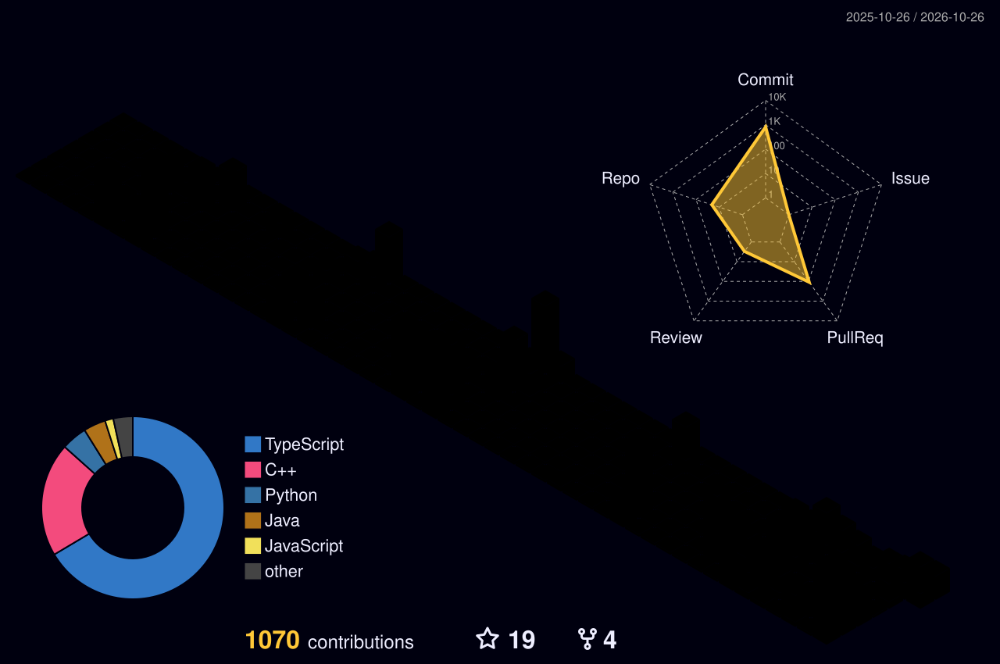

<!-- HEADER BANNER -->

  

<!-- TYPING SVG -->

  

<!-- SOCIAL & PROFILE BADGES -->

  
  
  
  

<!-- ABOUT ME -->
<table>
  <tr>
    <td valign="center" width="60%">
      <h2>🕵️‍♂️ <code>whoami</code> // About Me</h2>
      <blockquote>
        <em>"No, I'm not a furry—I just like Aiden Pearce."</em> 🦊📱
      </blockquote>
      <ul>
        <li>🧠 <strong>AI & ML Engineer:</strong> Designing and deploying <strong>LLM applications, RAG architectures, autonomous AI agents, and Deep Learning models</strong> with <code>PyTorch</code>, <code>Hugging Face</code>, and <code>LangChain</code>.</li>
        <li>🔭 <strong>Self-Taught Full-Stack Developer:</strong> Building scalable backends, high-performance APIs, modern web apps, and developer tools.</li>
        <li>🔓 <strong>Reverse Engineering & Low-Level Systems:</strong> Dissecting binaries and low-level internals by abusing Google, documentation, and StackOverflow 😉</li>
        <li>🚩 <strong>CTF Player & Hackathon Enthusiast:</strong> Breaking systems to understand how to harden and secure them.</li>
        <li>⛏️ <strong>Minecraft Nerd:</strong> Tinkering with Java/Kotlin plugins, Skript, and custom server mechanics.</li>
        <li>⚡ <strong>Mission:</strong> Contribute to open-source AI, security, and developer ecosystems that make a real-world impact.</li>
      </ul>
    </td>
    <td valign="center" width="40%" align="center">
      
    </td>
  </tr>
</table>

 

<!-- TECH ARSENAL / SKILLS -->
<h2 align="center">🛠️ Tech Arsenal, Languages & Tools</h2>

  <h4>💻 Programming, Scripting & Markup Languages</h4>
  

    
    
    
    
    
    
    
    
    
    
    
    
    
    
    
    
    
  

  <h4>🧠 AI Engineering, LLMs, Agents & MLOps</h4>
  

    
    
    
    
    
    
    
    
    
    
    
    
    
    
    
    
    
  

  <h4>📊 Data Science, Computer Vision & Vector Databases</h4>
  

    
    
    
    
    
    
    
    
    
    
    
    
    
    
  

  <h4>🌐 Full-Stack, Backend & APIs</h4>
  

    
    
    
    
    
    
    
    
    
    
    
    
    
    
  

  <h4>🚩 Reverse Engineering, Cybersecurity & CTF</h4>
  

    
    
    
    
    
    
    
    
    
    
  

  <h4>⚙️ Systems, Databases, Cloud & DevOps</h4>
  

    
    
    
    
    
    
    
    
    
    
    
    
    
    
    
    
    
    
    
    
    
    
  

   

  <!-- SKILL ICONS DOCK -->
  

 

<!-- FEATURED PROJECTS / REPOSITORIES -->
<h2 align="center">🚀 Featured Repositories & Architecture</h2>

  
  
   
  
  
  <!-- Optional 3rd Row: Uncomment after adding About descriptions to Vanguard / CRB -->
   
  
  
  

 

<!-- GITHUB STATISTICS -->
<h2 align="center">📊 GitHub Analytics & Achievements</h2>

  <!-- GitHub Trophies (Working Mirror) -->
  

 

<!-- Row 1: GitHub Stats & Streak Stats -->

  
  

<!-- Row 2: Top Languages, Productive Time & Repos Per Language -->

  
  
  

 

<!-- Row 3: Full-Width Contribution Activity Graph -->

  

 

<!-- INTERACTIVE & 3D CONTRIBUTION VISUALIZATIONS -->
<h2 align="center">🏙️ 3D Neon Cyberpunk Contribution City</h2>

  

 

<h2 align="center">🕹️ Arcade Contribution Graphs</h2>

<!-- PAC-MAN CONTRIBUTION GRAPH -->

  <h4>👻 Pac-Man Contribution Arcade</h4>
  <picture>
    <source media="(prefers-color-scheme: dark)" srcset="https://raw.githubusercontent.com/x-TheFox/x-TheFox/output/pacman-contribution-graph-dark.svg">
    <source media="(prefers-color-scheme: light)" srcset="https://raw.githubusercontent.com/x-TheFox/x-TheFox/output/pacman-contribution-graph.svg">
    
  </picture>

 

<!-- SNAKE CONTRIBUTION GRAPH -->

  <h4>🐍 Contribution Grid Snake</h4>
  <picture>
    <source media="(prefers-color-scheme: dark)" srcset="https://raw.githubusercontent.com/x-TheFox/x-TheFox/output/github-contribution-grid-snake-dark.svg">
    <source media="(prefers-color-scheme: light)" srcset="https://raw.githubusercontent.com/x-TheFox/x-TheFox/output/github-contribution-grid-snake.svg">
    
  </picture>

 

<!-- RANDOM DEV QUOTE -->

  

<!-- FOOTER WAVE -->

  

